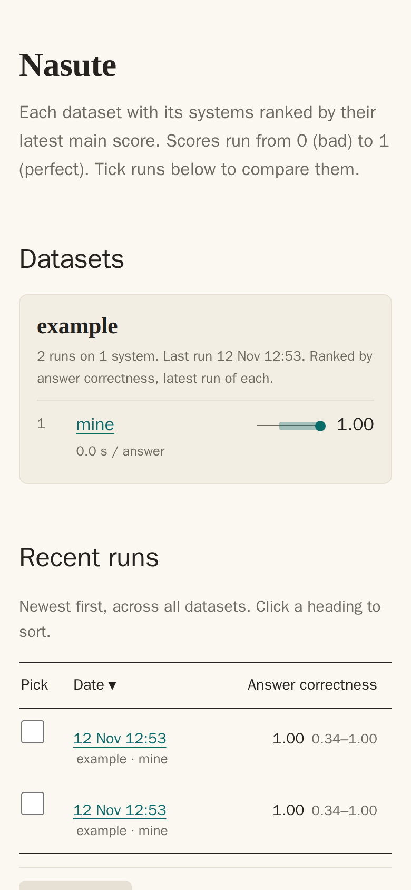
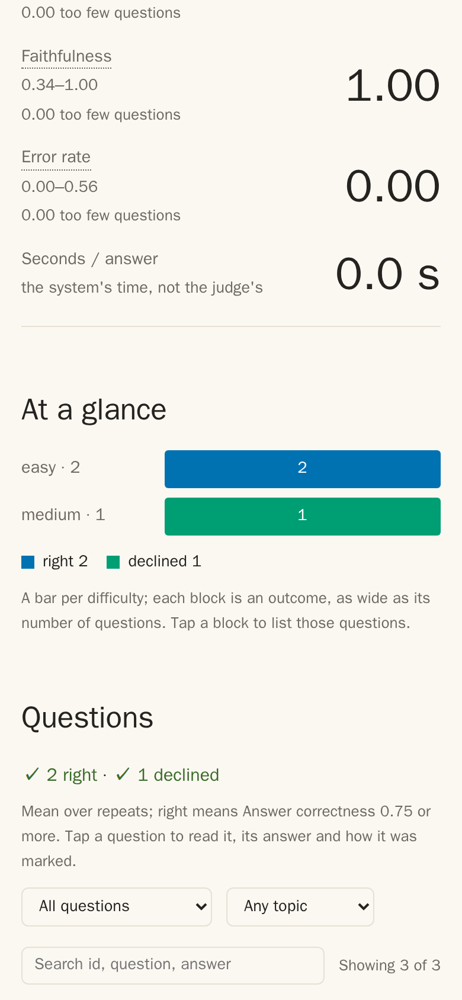

# Nasute


Nasute (NAY-soot) is a lightweight evaluation framework for LLMs and LLM agents: it asks a system questions with known answers, has a judge mark them, and tells you whether a change made things better, worse or no different, with error bars.

Named after the nasute, the soldier termite that guards the colony: Nasute guards your system against answers that quietly drift wrong.

<p>


</p>

*The demo report on a phone: the front page, and a run page with its outcomes at a glance.*

## Features

- **Any system as the target.** A plain chat model, a search-and-answer system (RAG), or anything else behind an HTTP endpoint. Anything without one takes [one Python function](docs/how-to/add-a-target.md).
- **Chat models with no setup.** `kind = "chat"` takes an OpenAI-compatible address and a model name; no JSON paths ([add a target](docs/how-to/add-a-target.md#a-chat-model)).
- **Several targets in one command.** `run_targets`, or `--target` given more than once, runs each on the same questions and ranks them ([how](docs/how-to/compare-runs.md#run-several-targets-in-one-command)).
- **Three judge modes.** Pick one per run:

  | Mode | Use it for | Cost and speed |
  | --- | --- | --- |
  | `quick` | Most runs. Checks each claim in the answer against the sources and the reference. | One judge request per answer. Cheap. |
  | `claims` | Careful runs. Splits the answer and the reference into single facts and checks each, so you see the facts behind every score. | Several requests per answer. About twice as slow. |
  | `knowledge` | Plain chat models that cite nothing. Is the key fact there, and is anything false? | One request per answer. |

- **The judge only says yes or no.** It never gives a score. Ordinary code counts its verdicts, so every score traces back to single claims ([why](docs/explanation/why-the-judge-says-yes-or-no.md)).
- **Error bars and honest compares.** Every score has a 95% range. Comparing two runs says "real gain", "real drop" or "within noise" ([statistics](docs/explanation/statistics.md)).
- **Honesty on unanswerable questions.** Ask about made-up names, and Nasute scores whether the system says it doesn't know or makes something up.
- **A check on the judge.** `judge-check` marks hand-labelled answers with known faults, and reports how often the judge gets them right ([check the judge](docs/how-to/judge-check.md)).
- **Fenced judge prompts.** The answer goes to the judge first, between markers, with the trusted reference after it, so an answer that forges a `REFERENCE:` line does not fool the judge. On by default; `[judge] fence = false` gives the 0.1.0 prompts ([why](docs/reference/judge-prompts.md#the-fence)).
- **Custom judge prompts.** The built-in prompts are the default. Replace any one with a text file named in `[judge.prompts]` ([how](docs/how-to/change-the-judge-prompts.md)).
- **Retrieval scores, when your system cites sources.** Hit rate, recall, MRR and faithfulness to the text it read. Left out when a system names no sources.
- **Tags and difficulty.** Scores by topic, and by easy, medium and hard ([tag questions](docs/how-to/tag-questions.md)).
- **Tokens and cost.** For the answers and for the judging, when the system and the judge report them.
- **A spending cap.** `max_cost` stops a run from asking new questions once answers plus judging cost more than you set ([settings](docs/reference/settings.md)).
- **Questions side by side.** `concurrency` asks several at once for a cloud API, with the judge's own limit; it stays 1 for a local model.
- **A static report.** Plain HTML files that work offline and on a phone. No server needed.
- **Standard library only.** Python 3.11 or newer, nothing else to install.

## Quick start

**Install.**

```bash
pipx install nasute
```

**Try the demo**, with no account and no model. Start the stand-in system and judge in one terminal, then run in a second:

```bash
nasute demo-server                      # leave it running
nasute init try --demo && cd try        # in a second terminal
nasute run --profile smoke
```

**Point it at your own model.** Run `nasute init mytest`, then edit `[targets.mine]` and `[judge]` in `mytest/nasute.toml`. Ready-made settings: [an OpenAI-compatible API](examples/openai-compatible.toml) and [Ollama](examples/ollama.toml).

```bash
cd mytest && nasute run --profile smoke
```

**Open the report.** Open `report/index.html` in a browser, or serve it and visit `http://127.0.0.1:8765/`. To have the printed link use your own web address, set `report_url` ([settings](docs/reference/settings.md)).

```bash
nasute serve
```

The full walk-through is the [Quick start](docs/tutorial.md). To run from a clone, or change the code, see [CONTRIBUTING.md](CONTRIBUTING.md).

## How do I…

- [test my own endpoint or model?](docs/how-to/add-a-target.md)
- [write questions, and change them safely?](docs/how-to/write-a-dataset.md) Or [import them from a spreadsheet](docs/how-to/import-a-csv.md).
- [tag questions?](docs/how-to/tag-questions.md) Tags group the scores in the report, by topic and by difficulty.
- [compare two models, or two runs?](docs/how-to/compare-runs.md)
- [mark a baseline, or label a run?](docs/how-to/baselines-and-labels.md)
- [see why a question failed?](docs/how-to/read-a-run-page.md)
- [take the results into a spreadsheet?](docs/how-to/export-a-run.md)
- [use a hosted model as the judge?](docs/how-to/use-a-cloud-judge.md)
- [check the judge marks fairly?](docs/how-to/judge-check.md)
- [change the words the judge is sent?](docs/how-to/change-the-judge-prompts.md)
- [run a long test overnight?](docs/how-to/run-overnight.md)

## Documentation

All of it is in [docs/](docs/README.md): a [Quick start](docs/tutorial.md), [How Nasute works](docs/how-nasute-works.md), [how-to guides](docs/how-to/README.md), a [reference](docs/reference/README.md) and [explanations](docs/explanation/README.md).

## This repo

| Path | What |
| --- | --- |
| `src/nasute/__init__.py` | The tool: settings, datasets, statistics, judge, runs, compare, command line. |
| `src/nasute/manage.py`, `pages.py` | `dataset` and `runs` commands; the static report. |
| `src/nasute/demo_server.py` | `nasute demo-server`: a stand-in system and judge for the quick start. |
| `src/nasute/targets/` | The built-in kind of target, `http`. Your own is a `module:function` in the settings. |
| `src/nasute/datasets/` | `demo`: ten questions about a made-up garden handbook (`demo/handbook.md`). `judge-demo`: answers with known faults, to test the judge. |
| `src/nasute/assets/` | The report page script and style, and three vendored libraries (MIT, each with its licence file): uPlot 1.6.32, Chart.js 4.5.1 and @sgratzl/chartjs-chart-boxplot 4.4.5. Versions and SHA-256 are in [data layout](docs/reference/data-layout.md). |
| `src/nasute/starter/` | What `nasute init` copies out. |
| `nasute.example.toml` | Every setting, explained. |
| `examples/` | Ready settings for a model behind an OpenAI-compatible API, and for one run locally by Ollama. |
| `tests/nasute_test.py` | Checks, with made-up data: `python3 tests/nasute_test.py`. No network, no model, no install. |

## Contributing and security

See [CONTRIBUTING.md](CONTRIBUTING.md). To report a security problem, see [SECURITY.md](SECURITY.md).

## Licence

MIT (see `LICENSE`). The vendored chart libraries keep their own MIT licences, in `src/nasute/assets/`.
