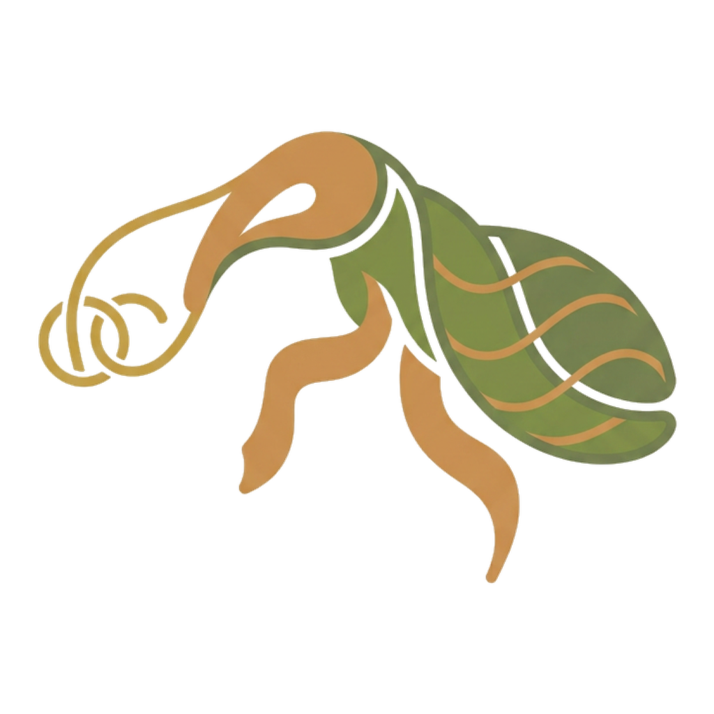

# Nasute



A self-hosted eval harness for RAG (retrieval-augmented generation: a system that looks things up and then writes an answer) and for language models. It asks a system questions with known answers, has a second AI mark the answers claim by claim, counts, and keeps every run. It tells you whether a change made things better, worse or no different, with a 95% range on every number. Named after the nasute, the soldier termite that guards the colony.

Plain Python 3.11 or newer, standard library only. Any system you can ask a question over HTTP is a target, and anything else takes one Python function.

## Quick start

**Install.** Nasute uses only Python's standard library, so pipx is the way to install it; there is no Docker image, and none is needed.

```bash
pipx install nasute                     # or, until it is on PyPI: pipx install git+https://github.com/bobbyely/nasute
```

**Try the demo**, with no account and no model. In one terminal start the stand-in system and judge, and in another make a folder set up for it and run:

```bash
nasute demo-server                      # leave it running
nasute init try --demo && cd try        # in a second terminal
nasute run --profile smoke
```

Each question gets a line as it is marked, such as `[2/3] water-boils ... right (0.0 s)`. The run ends with its scores, each with a 95% range, and a link to its page in the report.

**Point it at your own model.** Run `nasute init mytest` (without `--demo`) and edit `[targets.mine]` and `[judge]` in `mytest/nasute.toml`. Ready-made settings: [a model behind an OpenAI-compatible API](examples/openai-compatible.toml) and [a model run by Ollama](examples/ollama.toml). Then `nasute run --profile smoke` from that folder.

**Open the report.** Open `report/index.html` in a browser, or run `nasute serve` and visit `http://127.0.0.1:8765/`. The front page shows each dataset with its systems ranked; click through to a dataset and then to a run, or tick runs to compare them. To have the printed link use your own web address, set `report_url` (see [settings](docs/reference/settings.md)).

Progress prints as short lines at a terminal and as JSON lines when the output goes to a file or a pipe, for a program that reads logs; `--log text` or `--log json` picks one ([commands](docs/reference/commands.md)).

The full walk-through is the [Quick start](docs/tutorial.md).

## How do I…

- [test my own endpoint or model?](docs/how-to/add-a-target.md)
- [write questions, and change them safely?](docs/how-to/write-a-dataset.md) Or [import them from a spreadsheet](docs/how-to/import-a-csv.md).
- [tag questions?](docs/how-to/tag-questions.md) Tags group the scores in the report, by topic and by difficulty.
- [compare two models, or two runs?](docs/how-to/compare-runs.md)
- [mark a baseline, or label a run?](docs/how-to/baselines-and-labels.md)
- [see why a question failed?](docs/how-to/read-a-run-page.md)
- [take the results into a spreadsheet?](docs/how-to/export-a-run.md)
- [use a hosted model as the judge?](docs/how-to/use-a-cloud-judge.md)
- [check the judge marks fairly?](docs/how-to/judge-check.md)
- [run a long test overnight?](docs/how-to/run-overnight.md)

## Documentation

All of it is in [docs/](docs/README.md): a [Quick start](docs/tutorial.md), [How Nasute works](docs/how-nasute-works.md), [how-to guides](docs/how-to/README.md), a [reference](docs/reference/README.md) and [explanations](docs/explanation/README.md).

## This repo

| Path | What |
| --- | --- |
| `src/nasute/__init__.py` | The tool: settings, datasets, statistics, judge, runs, compare, command line. |
| `src/nasute/manage.py`, `pages.py` | `dataset` and `runs` commands; the static report. |
| `src/nasute/demo_server.py` | `nasute demo-server`: a stand-in system and judge for the quick start. |
| `src/nasute/targets/` | The built-in kind of target, `http`. Your own is a `module:function` in the settings. |
| `src/nasute/datasets/` | `demo`: ten questions about a made-up garden handbook (`demo/handbook.md`). `judge-demo`: answers with known faults, to test the judge. |
| `src/nasute/assets/` | The report page script and style, and three vendored libraries (MIT, each with its licence file): uPlot 1.6.32, Chart.js 4.5.1 and @sgratzl/chartjs-chart-boxplot 4.4.5. Versions and SHA-256 are in [data layout](docs/reference/data-layout.md). |
| `src/nasute/starter/` | What `nasute init` copies out. |
| `nasute.example.toml` | Every setting, explained. |
| `examples/` | Ready settings for a model behind an OpenAI-compatible API, and for one run locally by Ollama. |
| `tests/nasute_test.py` | Checks, with made-up data: `python3 tests/nasute_test.py`. No network, no model, no install. |

## Contributing and security

See [CONTRIBUTING.md](CONTRIBUTING.md). To report a security problem, see [SECURITY.md](SECURITY.md).

## Licence

MIT (see `LICENSE`). The vendored chart libraries keep their own MIT licences, in `src/nasute/assets/`.
