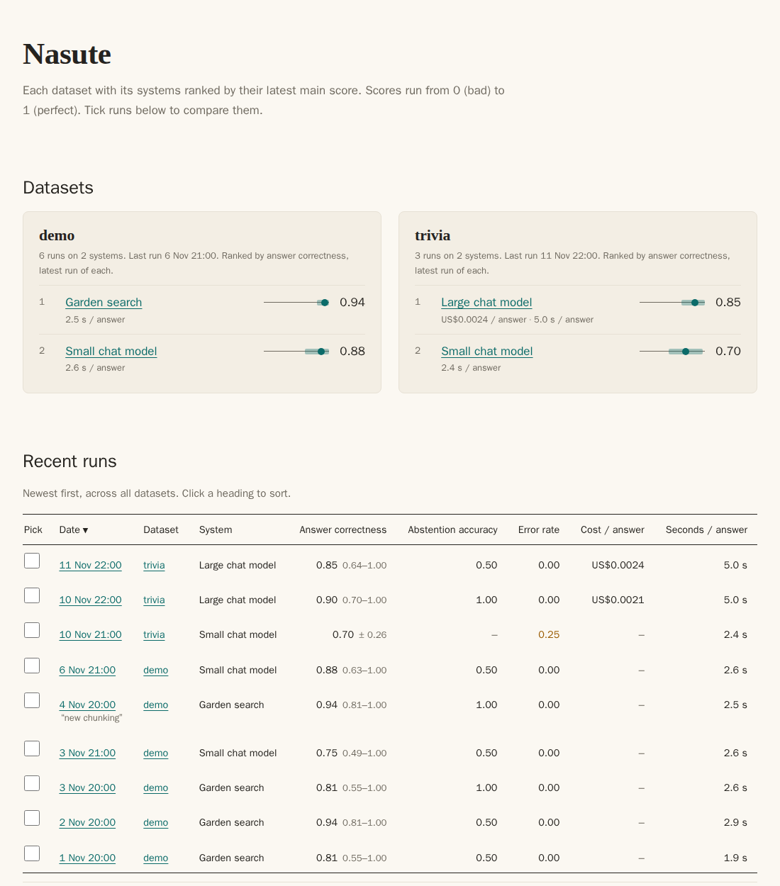

[Start here](README.md) · [Quick start](tutorial.md) · [How it works](how-nasute-works.md) · [How-to](how-to/README.md) · [Reference](reference/README.md) · [Explanation](explanation/README.md)

# Nasute

Nasute tests an AI system by asking it questions whose answers you already know. It marks what comes back, keeps every run, and tells you whether a change made things better, worse, or no different. It is written for anyone who builds or maintains a system that answers questions and wants evidence, rather than a feeling, that a change helped.

It is a command-line tool that needs Python 3.11 or newer and nothing else to install. The name comes from the nasute, the soldier termite that guards the colony.

## Who it is for

Suppose you have a system that answers questions: a chat assistant, a search-and-answer service (often called RAG, for retrieval-augmented generation, because the system looks things up before it writes an answer), or a model behind an API. You change it from time to time, and "it seems fine" is no longer good enough. Nasute gives you a fixed set of questions to ask before and after each change, and a plain-language verdict on what moved.

You do not need to know statistics. Nasute does the sums and says in words what they mean, and the [explanation pages](explanation/README.md) describe the method if you want the detail.

## A run in 30 seconds

*Questions go to your system, a second AI (the judge) says yes or no about each claim in the answers, and ordinary code counts the yeses and reports scores with error bars.*

A typical session has six steps.

1. You keep a file of questions with known answers.
2. Nasute asks your system each question and records the answer, along with the sources the system says it used.
3. A judge, which is a second language model, reads each answer and says yes or no about single claims, such as "does the source say this?". It never gives a score itself.
4. Nasute's own code counts the yeses and works out the scores. Each score comes with a 95% range (the 95% CI, or confidence interval) that shows how sure the number is.
5. Nasute writes a report of plain HTML pages that you open in a browser.
6. After your next change you run again, and Nasute compares the two runs question by question and reports "real gain", "real drop" or "within noise".

*The dashboard of a report. Each dataset gets a card with its systems ranked by their latest main score, with cost and seconds per answer where known. Below it, the recent runs of every dataset: tick any of them and compare.*

## Where to go next

Pick the page that matches what you want to do.

| You want to | Read |
| --- | --- |
| See it work on your own endpoint in 5 minutes | [Quick start](tutorial.md) |
| Understand the whole thing in 15 minutes | [How Nasute works](how-nasute-works.md) |
| Do one particular job | [How-to guides](how-to/README.md) |
| Look up a command, a setting, a score or a file | [Reference](reference/README.md) |
| Know why it is built this way and where it falls short | [Explanation](explanation/README.md) |

## All pages, in reading order

The pages follow the Diátaxis layout: a tutorial, task-focused how-to guides, reference pages to look things up in, and explanations of why.

**Start**

- [Start here](README.md): this page.
- [Quick start](tutorial.md): test your own endpoint in 5 minutes, with no account and no model.
- [How Nasute works](how-nasute-works.md): the pieces, a run's journey, how to read the report and what to trust.

**How-to guides** ([index](how-to/README.md))

- [Add a target](how-to/add-a-target.md): point Nasute at an HTTP endpoint or a Python function.
- [Write and version a dataset](how-to/write-a-dataset.md)
- [Import questions from a CSV](how-to/import-a-csv.md)
- [Tag questions and set difficulty](how-to/tag-questions.md)
- [Use profiles](how-to/use-profiles.md): a quick look and a careful run.
- [Compare two models on the same questions](how-to/compare-runs.md)
- [Baselines and labels](how-to/baselines-and-labels.md)
- [Read a run page](how-to/read-a-run-page.md)
- [Run a deep test overnight on a shared machine](how-to/run-overnight.md)
- [Use a cloud judge](how-to/use-a-cloud-judge.md)
- [Check the judge, and add judge items](how-to/judge-check.md)

**Reference** ([index](reference/README.md))

- [Commands](reference/commands.md)
- [Settings](reference/settings.md)
- [Scores](reference/scores.md): every score with its formula.
- [File formats](reference/file-formats.md)
- [Data layout](reference/data-layout.md)
- [Judge prompts](reference/judge-prompts.md): the exact words sent to the judge.

**Explanation** ([index](explanation/README.md))

- [The statistics](explanation/statistics.md)
- [Why the judge says yes or no](explanation/why-the-judge-says-yes-or-no.md)
- [How errors count](explanation/how-errors-count.md)
- [The judge-check](explanation/the-judge-check.md)
- [Independence](explanation/independence.md)
- [Limits](explanation/limits.md)

## What is in the folder

The code is in `src/nasute/`, the checks in `tests/`, and these docs in `docs/`. `nasute demo-server` starts a stand-in system and judge that lets you try everything without an account or a model.

---

[Next](tutorial.md) →

---

[Next](tutorial.md) →
