[Start here](../README.md) · [Quick start](../tutorial.md) · [How it works](../how-nasute-works.md) · [How-to](../how-to/README.md) · [Reference](../reference/README.md) · [Explanation](README.md)

# Explanation: why the judge only says yes or no

This page explains the main design decision in Nasute's marking: the judge never gives a score. You need it if you wonder why Nasute splits an answer into claims, or why you cannot simply ask the judge to rate an answer from 0 to 1.

Retrieval needs no judge, because whether a system found the right article is a list comparison. But the question "is this answer correct?" needs something that can read, and Nasute uses a language model for that, called the judge. The design rule is that **the judge never gives a score; it says yes or no about single claims, and the code counts.**

## The problem with asking for a score

If you ask a small model to rate an answer from 0 to 1, it might say 0.7, and nobody can check what 0.7 means. Ask again and it may say 0.8, and change the wording of the request and the number moves. A number like that cannot be audited, so it cannot be trusted, and a change of 0.1 between two runs could be nothing but the judge's mood.

## What the judge does instead

Nasute asks the judge two kinds of question, and in both cases a person can check the answer.

1. **List the claims.** The judge is asked what facts the answer states, and each one is written as a short sentence.
2. **Is each claim supported?** For each claim the judge is asked whether a source states it, with the answer yes or no. The source might be the extracts the system read, or the reference answer.

The judge also answers one three-way question, which is whether the answer addresses the question (yes, partly or no). That is Answer relevancy (does the answer address the question), counted as 1, 0.5 and 0, and it is the weakest mark, as described in [limits](limits.md). For each claim the judge adds a few words of reason, and those are kept so that a person can check the judge's work.



*Yes and no verdicts go in, the code counts them, and the scores come out.*

Then Nasute's own code does the arithmetic. For an answer with 10 claims of which the extracts back 8, it writes:

```text
Faithfulness (share of the answer's claims backed by the text it read) 0.80 = claims backed by the extracts / claims in the answer = 8 / 10.
```

That sentence is stored with the score (as `reasons` in `results.jsonl`) and shown on the run page next to the claims, each with a tick or a cross, so if you disagree with a score you can find the exact claim and verdict behind it.

## Two modes

Nasute has two judge modes, which trade speed against how much of the answer they can see.

**quick** is the default and makes one request per answer. The judge lists the answer's claims and, for each, says whether the extracts back it and whether the reference agrees, contradicts it or does not cover it. Answer correctness is then the share of the answer's claims that agree with the reference. This mode cannot see facts that the answer left out, so a one-word answer to a question with a three-part reference can still score 1.

**claims** is about four times slower (measured on a small local model, about 82 seconds of judging per answer against about 20), and it follows the RAGAS style. One request splits both the answer and the reference into single facts, and four more requests check them: answer facts against the extracts, answer facts against the reference, reference facts against the extracts, and reference facts against the answer. Answer correctness is the F1 score (the balance of precision and recall) of precision (answer facts found in the reference) and recall (reference facts found in the answer). Context recall (the share of the reference's facts present in the text it read) comes free as the share of reference facts found in the extracts. Claims mode sees what is missing as well as what is wrong.

Faithfulness and Answer relevancy follow RAGAS (Es et al., 2023, "RAGAS: Automated Evaluation of Retrieval Augmented Generation", [arXiv 2309.15217](https://arxiv.org/abs/2309.15217)), with two differences: Nasute does not regenerate questions to work out relevancy, and it counts a claim as backed with one yes or no instead of using an entailment model. Answer correctness as an F1 of precision and recall over single facts, and Context recall, follow common practice in RAG evaluation, so they are Nasute's own choices here and not definitions from that paper. In claims mode a true extra detail that the reference lacks counts against precision.

## Guard rails

Several safeguards keep the judge's replies trustworthy.

- **The reply has a fixed shape.** The judge is asked for JSON that matches a schema, and the code checks every reply against it. A made-up verdict ("INVALID"), a missing field, or a different number of verdicts than claims is rejected and retried, and if it still fails, that answer is a judge error and is left out of the judged scores rather than scored 0.
- **The question travels with the reference.** When facts are checked against the reference, the prompt includes the question, so a bare "Canberra" is read as an answer to it.
- **Every judge call stands alone.** Each call is one message with no history, as described in [independence](independence.md).
- **A judge can be wrong.** That is what [the judge-check](the-judge-check.md) measures.

The prompts themselves are in [judge prompts](../reference/judge-prompts.md), word for word.

## Unanswerable questions

For a question marked `"answerable": false`, the judge gets one question only: did the answer decline (say that it cannot find the information or does not know) or make something up? Abstention accuracy is 1 for a decline and 0 for a made-up answer, and hedging while still giving a specific answer counts as making something up. The other answer scores are left empty for these questions.

---

← [Previous](statistics.md) · [Next](how-errors-count.md) →
