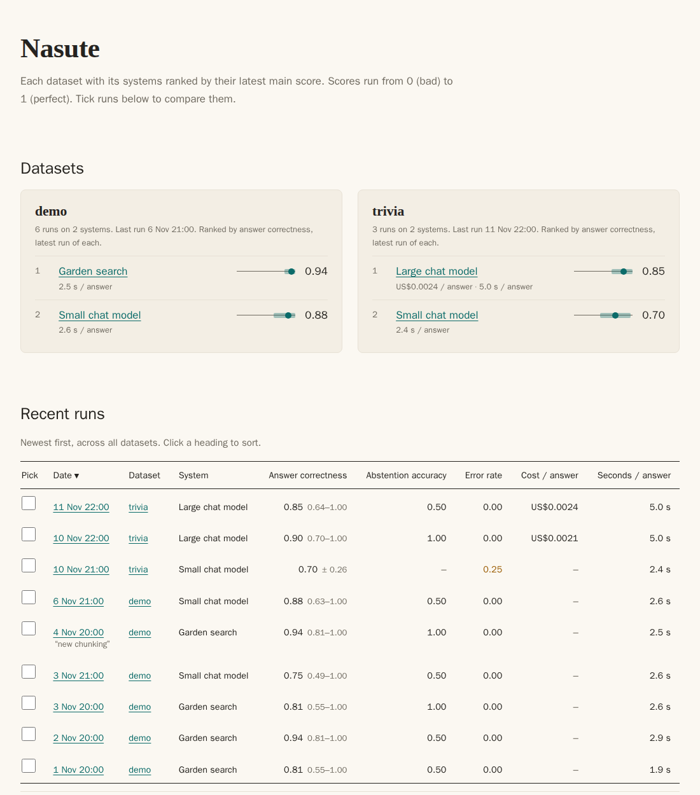
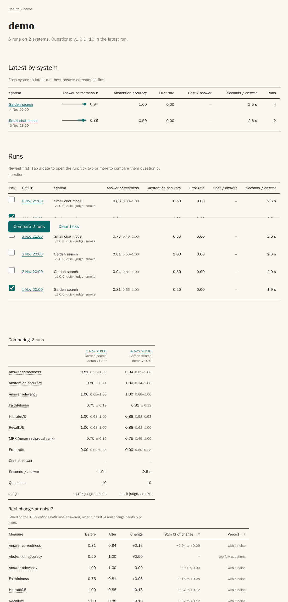
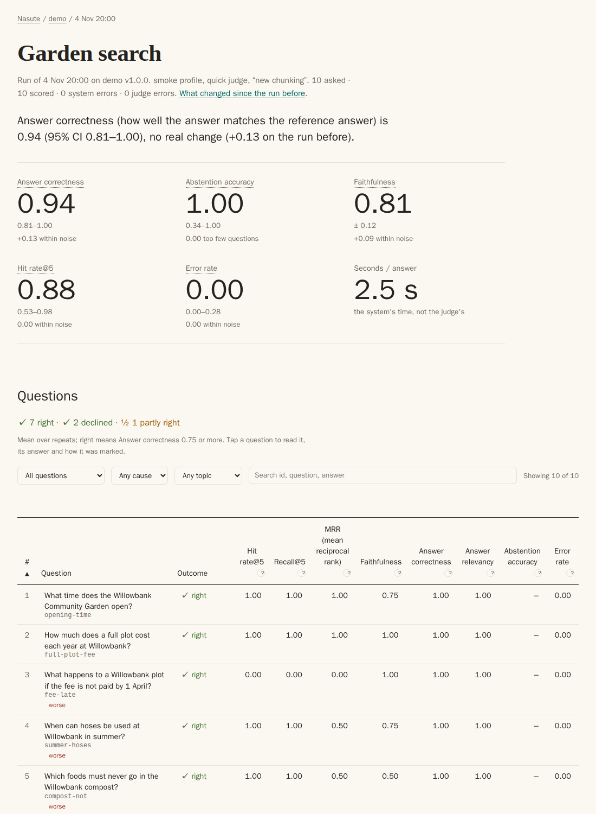
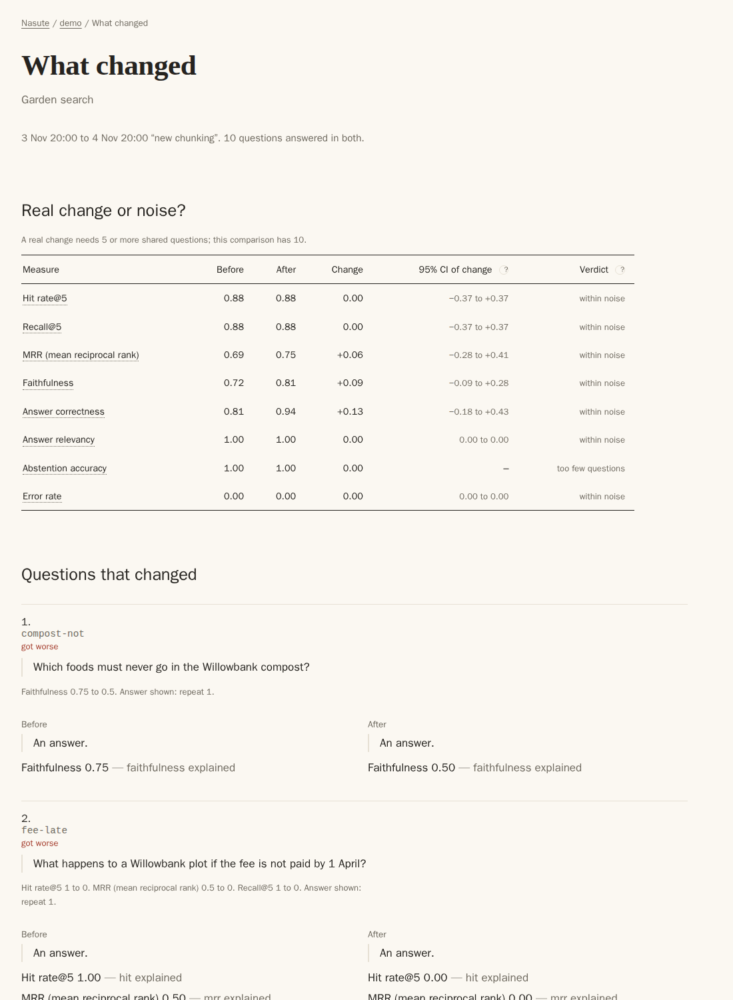

[Start here](README.md) · [Quick start](tutorial.md) · [How it works](how-nasute-works.md) · [How-to](how-to/README.md) · [Reference](reference/README.md) · [Explanation](explanation/README.md)

# How Nasute works

This page explains the whole tool in about 15 minutes: what the pieces are, what happens during a run, how to read the report, and how far to trust the numbers. It is written for someone who has not used Nasute before, and it is worth reading once before the how-to guides and the reference pages.

**The short answer.** Nasute asks your system a fixed list of questions, has a second AI check the answers claim by claim, and counts. Every score comes with a 95% range once at least one question has been scored; when the scores have no spread, or only one attempt was scored, the range comes from a Wilson interval that counts questions instead of attempts. When you compare two runs, Nasute tells you whether the change is real or noise, and because it keeps everything, you can trace any number back to the claim behind it.

**Two things to remember.** First, the AI judge never gives a score. It says yes or no about single claims, and ordinary code does the counting. Second, small samples give wide ranges, so read the range before you read the number.

## The pieces

Nasute has seven moving parts, and a few words are used in a specific way throughout the docs. The diagram shows how they relate, and the table says what each one is and where it lives.

*A dataset is asked of a target. One dataset with one target is a suite, and each run of a suite is saved and can become the baseline.*

| Piece | What it is | Where it lives |
| --- | --- | --- |
| **Target** | The system under test. It is a `[targets.<name>]` table with a `kind`: `http` for any JSON endpoint, or `module:function` for your own Python function. | `nasute.toml` |
| **Dataset** | Questions with known answers, in versioned files. A file is never edited, so a change becomes the next version. Its first line names the target it is for. | `datasets/<name>/v<N>.jsonl` |
| **Suite** | One dataset asked of one target, written `dataset@target`. Runs, baselines, charts and comparisons are grouped by suite. | in names |
| **Profile** | A named set of settings merged over the base ones. `smoke` is a quick look and `deep` is a careful run. | `[profiles.<name>]` |
| **Run** | One pass over a dataset, in which every question is asked, judged, scored and saved. | `runs/<UTC time>/` |
| **Baseline** | The run you measure against, chosen by you, with one per suite. | `runs/index.json` |
| **Report** | Static HTML pages written from the saved runs. | `report/` |

The judge is separate from all of these. It is any OpenAI-compatible address that you set in `[judge]`, and it is kept apart from the target so that you can change one without touching the other.

## A run's journey

A run follows the same path for every question, which is shown below and then described step by step.

*One question's path: it is asked, answered, judged claim by claim and counted, and the counts are folded into scores with ranges.*

1. **Dataset.** Nasute reads the newest version of the dataset, or the one you name, and records the file's SHA-256 fingerprint so that a run is always tied to the exact questions.
2. **Target.** Each question goes to your system, which returns the answer and, if you have told Nasute where to find them, the titles of the sources and the text it read (the extracts). A timeout or error at this step is the system's fault and counts against it.
3. **Retrieval scores.** If the question lists the right sources, code compares them with the sources the system found, and this needs no AI. The scores are Hit rate@k (a right source was among the top k found), Recall@k (the share of the right sources found in the top k) and MRR (mean reciprocal rank, which says how near the top the first right source came).
4. **Judge.** A language model reads the answer and says yes or no about single claims, such as whether a claim is backed by the extracts or agrees with the reference. In `quick` mode this is one request per answer. In `claims` mode the answer and the reference are split into single facts that are each checked, which is about four times slower (measured on a small local model, about 82 seconds of judging per answer against about 20).
5. **Code counts.** The judge's yeses become Faithfulness, Answer correctness, Answer relevancy, Context recall and Abstention accuracy. Each score is saved with a sentence that shows the count, such as `Faithfulness 0.80 = claims backed by the extracts / claims in the answer = 8 / 10`.
6. **Scores with ranges.** The per-question scores are averaged, and each average gets a standard error and a 95% CI (the range the true score is probably in). Repeats of one question are treated with care because they are not independent of each other.
7. **Report.** Everything is written to `runs/`, and the report is rebuilt from it.

### A real run

To see real numbers, this section uses one real deployment, which is the case Nasute was first built for. It is a question-answering service that searches an offline copy of Wikipedia, and it runs on an old laptop with a small local model (Qwen2.5-7B) that both writes the answers and judges them. The dataset is 32 Wikipedia questions written by hand, and the full run `20261029T121042Z` asked 32 questions: 27 with answers and 5 with none. It used one repeat and the quick judge, took 42 minutes, and ended with the line `32 asked · 32 scored · 0 system errors · 0 judge errors`.

| Score | Value | 95% CI (range) | Questions |
| --- | --- | --- | --- |
| Answer correctness | 1.00 | 1.00 to 1.00 as saved (about 0.87 to 1.00 by today's rule) | 27 |
| Faithfulness | 1.00 | 1.00 to 1.00 as saved (about 0.87 to 1.00 by today's rule) | 27 |
| Hit rate@5 | 0.85 | 0.68 to 0.94 | 27 |
| Abstention accuracy | 1.00 | 0.57 to 1.00 | 5 |

There are four things to notice in these numbers.

- **Hit rate@5 is 0.85, which means 4 of the 27 questions did not find a listed source.** In all four cases the system had found a related article rather than the one the dataset names, and the answers were still right. The score therefore measures "found the article we listed", which is stricter than "found a useful article".
- **Abstention accuracy is 5 of 5, but its range starts at 0.57.** Five questions cannot rule out a true rate of about 0.6, and more questions would narrow the range.
- **Answer correctness and Faithfulness are a perfect 1.00 on all 27 questions.** Because every question scored exactly 1, there is no spread to measure, so Nasute now uses a Wilson interval that counts questions, which gives about 0.87 to 1.00 for 27 questions instead of a range of zero width. This run was made before that rule, so its saved summary still shows 1.00 to 1.00. The practical meaning is that the test is too easy to tell this system from a better one, which is called a ceiling effect (see [limits](explanation/limits.md)).
- **The judge and the system are the same model.** A model tends to be kind to its own text, which is why the next section matters.

## How to read the report

You open `report/index.html`, and from there the report goes dashboard, then dataset, then run. A fourth kind of page compares two runs. The screenshots below come from a demo report with made-up data.

A score with nothing to show is left out everywhere rather than shown as 0: the source scores of a system that names no sources, Faithfulness when the judge mode does not measure it, and any score set only on attempts that failed. A chart with nothing in it is left out too, such as a trend with fewer than two runs. "–" means not measured, and is never coloured like a bad score.

**Dashboard.** The front page has a card for each dataset, with its systems ranked by the main score of their latest run (Answer correctness, or the first score that dataset measures), shown as a dot on a 0 to 1 track with a band for the 95% range, plus cost and seconds per answer where they are known. Below the cards is a table of recent runs across every dataset, newest first. Tick any runs and press Compare to see their headline scores side by side. Runs on different datasets asked different questions, so the page says that this is not a like-for-like test; for runs on one dataset it links to the dataset page, which compares them question by question. A line at the bottom says which judge marked the runs and how its latest check went.

*The dashboard: each dataset with its systems ranked, then the recent runs to tick and compare.*

**Dataset page.** One dataset and every system tested on it. "Latest by system" ranks the systems by their latest run. "Runs" lists every run, newest first, one row each: date, system, main scores, cost and speed. Tap a date to open the run, or tick two or more runs to compare them: their scores side by side, a "real change or noise?" table with the paired test when you pick two runs of the same questions, and a question-by-question grid of outcomes (by default only the questions where the runs differ). Then come the scores over time for one system at a time, where a small triangle marks every run you labelled (see `nasute run --label`).

*A dataset page: the systems ranked, every run, and two runs compared.*

**Run page.** This is where the numbers are. It gives the answer first, as one sentence and the headline scores, each with its 95% range and its change against the baseline (or the run before, when there is no baseline), and cost and seconds per answer. Next comes every question with its outcome: right, partly right (in knowledge mode, "right, with an error"), wrong, a system error, and for a question with no answer, declined or made something up. The list is 50 to a page; filter it by outcome, cause or topic, and sort by any column. Clicking a row opens that question on its own view, with its reference answer, the answer, the sources (as links when the system gives addresses for them), each claim with a tick or cross and the judge's reason, and the count sentence behind each score, so this is where you check the judge's work. Below the list are two charts of the questions, then the Scores table, the reasons questions failed, whether answers stayed the same across repeats, and the judge's reliability. Each run can also be downloaded as a CSV, as the saved results and as the summary: see [export a run](how-to/export-a-run.md). See [read a run page](how-to/read-a-run-page.md).

*A run page: the answer, the headline scores, then every question.*

The old suite pages, `report/<dataset>@<target>/index.html`, now send you on to the dataset page, so old links and bookmarks still work.

**Compare page.** This page puts two runs side by side. For each score it shows both means, the change, its range and a verdict of "real gain", "real drop" or "within noise", and then it lists each question that changed together with both answers.

*A compare page: a verdict for each score, followed by the questions that changed.*

## What to trust

Not every number in the report deserves the same trust, and this section says which ones to lean on.

- **Trust the verdict more than the number.** A change counts as real only when its range stays clear of zero, and "within noise" means the data cannot tell the change from chance.
- **Trust Answer correctness to tell a right answer from a wrong or empty one, and Faithfulness to tell whether the answer is grounded in the text the system read.** The judge-check (`judge-20261029T114345Z`) put 47 answers with known faults to the same judge. Faithfulness was in the expected range 100% of the time, with a Cohen's kappa of 1.00, where 1 means perfect agreement beyond chance. Answer correctness was in range 96% of the time (kappa 0.74). Faithfulness is not a truth test, because a claim that the extracts support scores as backed even if it is false, and an answer with no claims is not measured. See [the judge-check](explanation/the-judge-check.md).
- **Do not lean on Answer relevancy.** In the same check it was in range only 72% of the time (kappa 0.51). A small judge blurs "on topic" with "true": all 13 of its misses were wrong, half-right or hedged answers that the judge marked "no" or "partly" even though they address the question, so you should read it as rough.
- **Be careful with small samples.** Under 5 shared questions there is no verdict, and with fewer than about 30 questions the ranges are still a little too narrow. The "power" line on a run page tells you how many questions it would take to see a 0.05 change.
- **Watch for a judge that marks its own homework.** If the judge is the same model as the system, it tends to be kind to its own text, so use a different and stronger judge if you can.
- **Look at the counting line.** A line such as "27 asked · 25 scored · 1 system error · 1 judge error" shows what was left out, and a run with too many judge errors is marked incomplete. See [how errors count](explanation/how-errors-count.md).

Where Nasute falls short is listed in [limits](explanation/limits.md).

---

← [Previous](tutorial.md) · [Next](how-to/README.md) →
