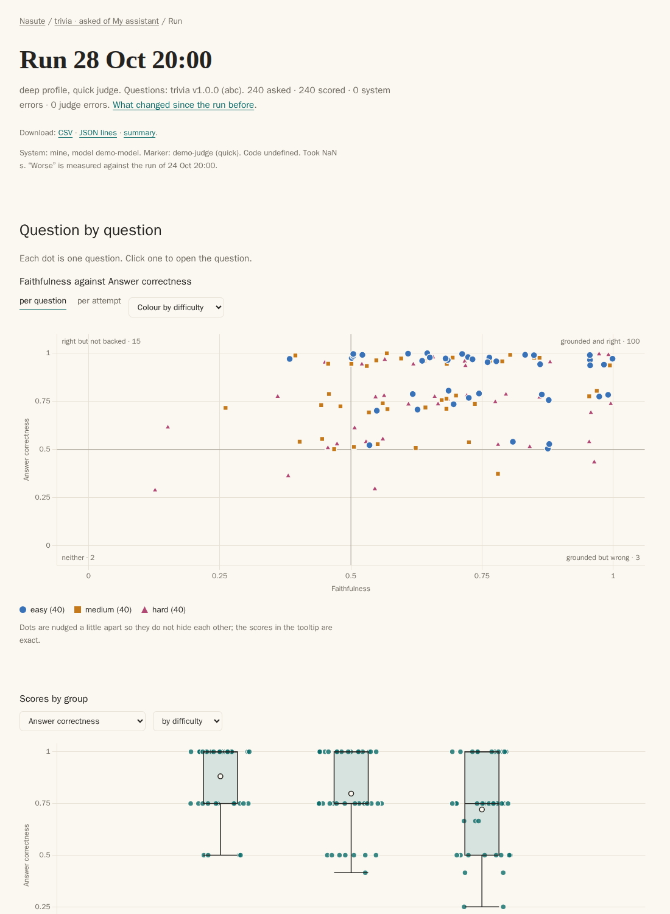

[Start here](../README.md) · [Quick start](../tutorial.md) · [How it works](../how-nasute-works.md) · [How-to](README.md) · [Reference](../reference/README.md) · [Explanation](../explanation/README.md)

# Read a run page

You use this guide when a score looks wrong and you want to see why. Every number in Nasute traces back to the claims behind it, and the run page is where you follow that trail.

1. Open `report/index.html` and click a run's date, in a dataset's card or in the table of recent runs. Or click the dataset's name and pick any run from its list. You can also open `report/<dataset>@<target>/runs/<run>.html` directly.
2. Read the counting line at the top of the page first, such as `32 asked · 32 scored · 0 system errors · 0 judge errors`, because it tells you what was left out of the scores. Under it are the answer in one sentence and the headline scores: only the scores this run measured are shown.
3. "At a glance" comes first: one bar for each difficulty (easy, medium, hard; one bar for all when the questions have none), split into a block per outcome, as wide as its number of questions. The colours are safe for colour blindness, the legend gives each count, and "not judged" is pale grey, never a bad colour. Tap a block to list just those questions; "Show every outcome" above the list undoes it.
4. The list "Questions" starts with a tally of outcomes, such as `✓ 18 right · ½ 2 right, with an error · ✗ 4 wrong · E 6 system error`. A question is right when its Answer correctness reaches `pass_at` (0.75 by default), partly right when it is above 0 (in knowledge mode a 0.5 reads "right, with an error"), and wrong at 0. A question with no answer reads "declined" or "made something up". The table has one row per question, with its number (`#`, its place in the dataset file), the question and its id, its outcome and, on a wide screen, its scores, topics, difficulty and cause. On a phone it shows only the number, the question and its outcome; open a question for the rest. You can show only the questions that were not right, the right ones, failed ones with a cause or ones that got worse, filter by cause, topic or text, and sort by any column. The filters and the sort apply to all the questions first, and the table then shows them 50 to a page, with Previous and Next buttons above and below. On a phone a list of more than 10 questions stops at 10, with a "Show all" button under it, so the charts and scores below stay close.
5. Click a row to open the question on its own view (see below), which shows the question, the reference answer, the answer, the sources the system found, and the sources you expected. When the system gives an address for a source, its name is a link that opens the page in a new tab. A link is only followed if it starts with `http://`, `https://` or a single `/`, so an address of any other kind stays plain text.
6. Under "Claims in the answer" each claim has two marks: the first says whether the extracts (what the system read) back it, and the second says whether it matches the reference. The judge's few words of reason sit beside each mark, and "Facts in the reference" shows the same thing the other way round (claims mode only).
7. "Scores, and how each was counted" shows the sentence behind each score, such as `Faithfulness 0.80 = claims backed by the extracts / claims in the answer = 8 / 10`.

*A run page from a demo report: the answer, the headline scores, then every question with its outcome.*

## The charts on the run page

Below the questions are the charts, drawn with one dot for each question, so you can see which questions sit behind a score before you read any of them. Hover over a dot, or move between dots with the arrow keys, to see the question and its scores. Click a dot, or press Enter, to open that question. On a phone, tap a dot once to see its tooltip and a second time to open it.

The scatter puts Faithfulness (how much of the answer the extracts back up) on the left-to-right axis and Answer correctness (how well it matches the reference) on the other, and a line at 0.5 splits it into four corners. The top right, "grounded and right", is where you want questions to be. The bottom right, "grounded but wrong", holds answers that the extracts support but that do not match the reference, which points at the retrieval step finding the wrong page, or at a reference the system cannot be expected to match. The top left, "right but not backed", holds correct answers that the extracts do not support, so the system may have answered from memory. The bottom left, "neither", is the worst. Each corner label shows how many dots are in it, and a score of exactly 0.5 counts as the high side. Scores cluster at 0, 0.33, 0.5 and 1, so the dots are nudged slightly apart; the tooltip always shows the exact scores. Switch between "per question" (the mean over its repeats) and "per attempt" to see the spread between repeats. A question with no Faithfulness score is left out, and a note says how many and why; an unanswerable question has none. When no question has a Faithfulness score (a chat model that reads no text, say, or knowledge mode), the scatter is left out altogether.

You can colour the dots by difficulty, by origin tag (the commonest tag after the first one), by topic (the first tag), or by failure cause, and the legend turns a group on or off. Only three groups get a colour of their own, and any more are folded into a grey "other", so the colours stay easy to tell apart; each group also has its own shape.

The distribution charts share one picker, "Group by": difficulty, tag (one group for each tag, and a question with two tags is in both), topic (when the questions have one) and failure cause (when any question has one). Groups run down the page, so many tags still fit a phone. Each chart is left out when it has nothing to show, and a value that was not measured is left out, never drawn as 0.

- **Score by group.** One score at a time (pick it beside "Group by" when the run measured more than one). Scores often take only 0, 0.5 and 1, and a box of those is a flat line, so a group whose scores take three values or fewer is drawn as a strip: its dots, spread a little up and down, and a ring for the mean. Otherwise a group of four or more is a Tukey box plot: the box is the interquartile range (IQR), from the first quartile (Q1) to the third (Q3), so it holds the middle half of the questions; the line is the median and the ring the mean; the whiskers reach the furthest question within 1.5 × IQR of the box. A smaller group shows only its dots, because quartiles of so few mean little. Left out when the run has a single question.
- **Seconds per answer, tokens out and cost per answer**, by the same groups: a box from four questions, dots below that. Each is left out when the system reported nothing for it.
- **Score against seconds per answer.** One dot per question, coloured by its group (the three biggest get a colour, the rest grey). It answers "do slow answers score better?". Left out when the system recorded no timing.

Every chart has a hidden table for screen readers, which lists each group with its count and its median and mean.

## One question on its own

Clicking a row or a dot shows just that question, across the whole page, and the address becomes `...<run>.html#q-<id>`, so you can send the link to someone else. The page shows a breadcrumb (the dashboard, the dataset, the run, and "Question 12"), the reference answer, the answer for each repeat with its sources, the claims and the count sentence behind every score, and the timings. "Previous question" and "Next question" follow the order the table was showing, including its filters and sort, so you can step through just the failed ones. The browser's Back button returns to the table on the page that holds the question, scrolled to where you were, and the table keeps its filters and sort.

## Marking a change on the charts over time

Give a run a label when you start it, such as `nasute run --label "prompt change"`, or later with `nasute runs label`. On the dataset page the charts over time mark every labelled run with a small triangle, and hovering over that run shows its label, so you can see where a change happened.

## What to look for

Some patterns come up often, and each points to a different kind of problem.

- **A score is low but the claims look right.** The judge or the reference may be wrong, and the cause column shows `judge?`, which means "take a look" rather than "the judge is wrong".
- **The answer lists claims it never made.** The judge invented them, which has been seen on refusals, so it is a judge fault.
- **Hit rate@k is 0 but the answer is right.** The system found a related article instead of the one the dataset lists, so you need to decide whether the dataset should list both.
- **A system error or judge error line appears.** A system error counts as 0 against the system, whereas a judge error leaves the answer out. See [how errors count](../explanation/how-errors-count.md).

The causes are `retrieval` (the right article was not found), `generation` (it was found but the answer is still wrong), `judge?` (the marks disagree) and `system` (an error or timeout).

---

← [Previous](baselines-and-labels.md) · [Next](export-a-run.md) →
