[Start here](../README.md) · [Quick start](../tutorial.md) · [How it works](../how-nasute-works.md) · [How-to](../how-to/README.md) · [Reference](README.md) · [Explanation](../explanation/README.md)

# Reference: scores

This page lists every score Nasute reports, together with its formula, and it is meant for the moment when you see a number and want to know exactly how it was worked out. The names, meanings and formulas below are the `GLOSSARY` in `nasute.py`, word for word, and the report shows the same text, so a test fails if this page and the code drift apart.

Scores run from 0 to 1, and higher is better except for Error rate. A run's average gives every scored attempt equal weight. A comparison between two runs gives every shared question's mean equal weight. Every score comes with a 95% interval once at least one question is scored: the normal interval when the scores vary, a Wilson interval (counting questions) when they do not or when there is a single attempt. See [the statistics](../explanation/statistics.md). "@k" is the setting `k` (default 5): Hit rate@5 counts the top 5 sources.

*The judge says yes or no about single claims. The code counts the yeses.*

Not every score can be measured for every question, and the table below shows what each score needs before Nasute can work it out.

| Score | Needs |
| --- | --- |
| Hit rate@k, Recall@k, MRR (mean reciprocal rank) | `sources` on the question and in the target's reply. No judge. |
| Faithfulness | `extracts` in the target's reply, and a judge. |
| Answer correctness, Answer relevancy | A judge. |
| Context recall | A judge in `claims` mode, and extracts. |
| Abstention accuracy | Questions with `"answerable": false`, and a judge. |
| Error rate | Nothing. |

A score that cannot be measured is shown as empty (a dash) and never as 0.

The glossary below gives each score's standard name, its "Key" (the name used inside the files `summary.json` and `results.jsonl` and in settings), a plain-language meaning, and the formula. Hit rate, Recall, MRR, Faithfulness, Answer correctness, Answer relevancy, Context recall, Abstention accuracy and Error rate are the scores. Accuracy and Cohen's kappa belong to the [judge-check](../explanation/the-judge-check.md), not to a run. The other rows are supporting terms.

| Name | Key | In plain words | How it is worked out |
| --- | --- | --- | --- |
| Hit rate@k | `hit` | a right source was among the top k found | 1 if any expected source is in the top k, else 0. Averaged over questions. |
| Recall@k | `recall` | share of the right sources found in the top k | expected sources in the top k / expected sources. |
| MRR (mean reciprocal rank) | `mrr` | how near the top the first right source came | 1 / position of the first expected source (1, 0.5, 0.33, ...), 0 if none. |
| Faithfulness | `faithfulness` | share of the answer's claims backed by the text it read | claims in the answer backed by the extracts / claims in the answer. |
| Answer correctness | `correctness` | how well the answer matches the reference answer | Claims mode: F1 = 2 × P × R / (P + R); precision P = answer claims matching the reference / answer claims; recall R = reference facts the answer covers / reference facts. Quick mode: answer claims that agree with the reference / answer claims. Knowledge mode: 1 if the answer states the reference's key fact and nothing false, 0.5 if it states the key fact and something false, 0 otherwise. |
| Answer relevancy | `relevancy` | does the answer address the question | The judge says yes, partly or no. Counted as 1, 0.5, 0. |
| Context recall | `context_recall` | share of the reference's facts present in the text it read | reference facts backed by the extracts / facts in the reference. Claims mode only. |
| Abstention accuracy | `abstention` | says it doesn't know when there's no answer | For questions the library cannot answer: 1 if the judge says the answer declines, 0 if it makes something up. Knowledge mode: 0.5 if it declines but states something false. |
| Precision | `precision` | of what the answer says, how much matches the reference | answer claims matching the reference / all answer claims. |
| F1 score | `f1` | the balance of precision and recall | 2 × P × R / (P + R). |
| Standard error | `se` | how much the average would wobble if you drew other questions; smaller is surer | √(variance / n), plus a term for repeats of one question, which are not independent (Miller, eq. 4). |
| 95% CI (confidence interval) | `ci` | the range the true score is probably in | mean ± 1.96 × standard error, kept between 0 and 1. Wilson interval for yes/no scores. |
| Error rate | `error_rate` | share of attempts where the system failed | attempts with a system error (timeout, crash, error, empty answer) / attempts. Lower is better; a rise shows as a real drop. |
| Strict vs answered-only scores | `strict` | the headline scores count a system error as 0; answered-only leaves those attempts out | strict: system-error attempts count 0 for every score that needs an answer, so a system that times out on hard questions is not flattered. answered only: those attempts are left out. |
| Incomplete run | `incomplete` | too many judge failures for the scores to be trusted | judge errors / answers judged is more than max_judge_errors (default 0.1). The judge's failures are never held against the system, but the run has gaps. |
| Aborted run | `aborted` | stopped early because the system or the judge could not be reached | unreachable for 3 questions in a row. Partial results are kept; nothing is compared. |
| Paired difference (verdict) | `paired` | did a change really move a score, or is it noise | Per-question differences between two runs: mean ± 1.96 × their standard error. Interval clear of 0: real gain or real drop. Else within noise. |
| Accuracy | `accuracy` | share of the judge's marks that landed in the expected range | marks inside the band the judge set expects / marks checked. |
| Cohen's kappa | `kappa` | agreement beyond chance: 1 is perfect, 0 is no better than guessing | (agreement − agreement expected by chance) / (1 − agreement expected by chance), comparing each mark's 0 / 0.5 / 1 bucket with the bucket the set expects. |
| Pass^k | `pass_all` | share of questions answered well on every repeat | questions whose correctness was at or above pass_at on all k repeats / questions. |

## When the denominator is zero

Some formulas divide by a count that can be zero, for example when an answer makes no claims, and the rules below say what Nasute does in each such case.

- **No claims in the answer** (a refusal, an apology, an empty answer): Faithfulness is not measured, because there is nothing to back. In quick mode Answer correctness is 0 and its reason says "the answer states no facts". In claims mode, Faithfulness is not measured and Answer correctness is 0.
- **Claims mode, F1:** 0 when precision or recall is 0 or cannot be worked out (no answer claims, or no reference facts).
- **No reference facts** (claims mode): Context recall is not measured.
- **No extracts returned by the target:** Faithfulness and Context recall are not measured.
- **No expected sources on the question:** Hit rate@k, Recall@k and MRR are not measured for it. If the question lists sources and the target returns none, they are 0.

How the judge's yes and no answers become these numbers is in [why the judge says yes or no](../explanation/why-the-judge-says-yes-or-no.md). The exact wording sent to the judge is in [judge prompts](judge-prompts.md).

---

← [Previous](settings.md) · [Next](file-formats.md) →

---

← [Previous](settings.md) · [Next](file-formats.md) →

---

← [Previous](settings.md) · [Next](file-formats.md) →
