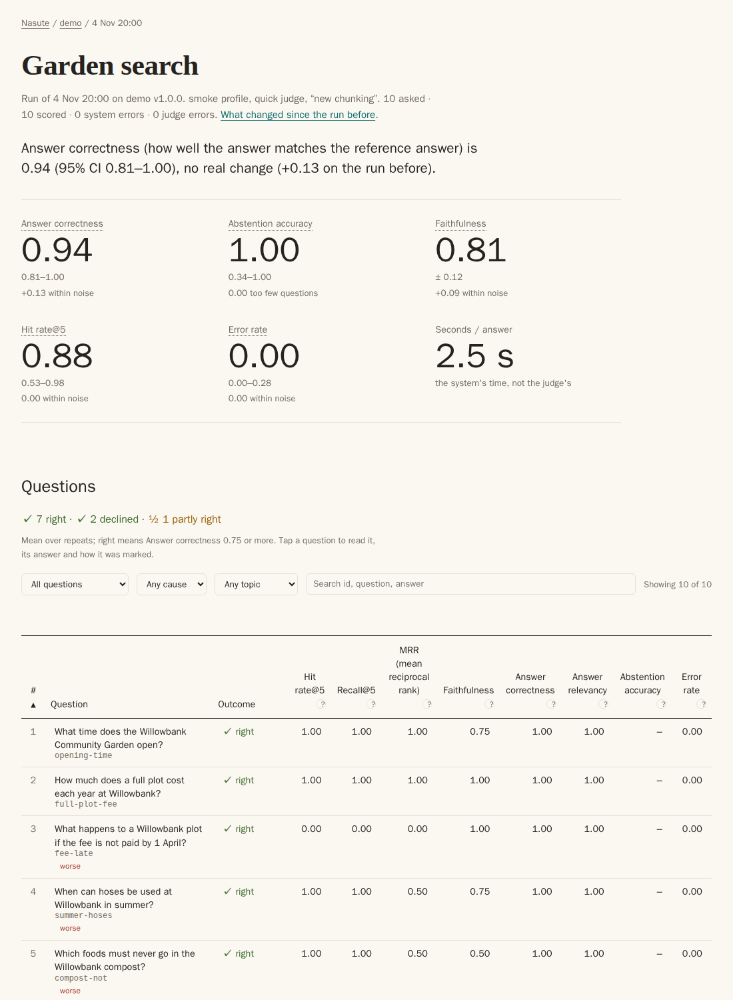

[Start here](README.md) · [Quick start](tutorial.md) · [How it works](how-nasute-works.md) · [How-to](how-to/README.md) · [Reference](reference/README.md) · [Explanation](explanation/README.md)

# Quick start

This tutorial takes about five minutes and walks you through testing your own endpoint, starting from an empty folder. To keep the first run free of accounts and models, you use a stand-in system and a stand-in judge that ship with Nasute, and at the end you swap in your own endpoint. You need Python 3.11 or newer and a terminal, and nothing else.

The scores from the stand-in only show that the pipeline works. They say nothing about any real system.

## 1. Start the stand-in

The stand-in is a small server that plays both roles: a system that answers a few questions, and a judge that marks the answers. Install Nasute, then start the stand-in in a terminal and leave it running.

```bash
pipx install nasute
nasute demo-server
```

It prints where the fake system (`/ask`) and the fake judge (`/v1`) are listening. Both are at `http://127.0.0.1:8700`, reachable only from this machine. You can stop it later with Ctrl-C.

## 2. Make a starter folder

Nasute keeps your settings, questions and results in one folder, and `nasute init` creates a starter one for you. Open a second terminal and run:

```bash
nasute init mytest
cd mytest
```

`init` writes two files and never overwrites anything: `nasute.toml`, which holds your settings, and `datasets/example/v1.jsonl`, which holds three example questions. When you run Nasute from this folder it finds `./nasute.toml` by itself.

## 3. Point it at the endpoint

Nasute needs to know where to send questions and where to find the answer in the reply. Open `nasute.toml` and make three edits, all marked in the file.

In `[targets.mine]`, set the address and remove the `#` from `sources` and `extracts`:

```toml
[targets.mine]
kind = "http"
url = "http://127.0.0.1:8700/ask"
request = { question = "{question}" }
answer = "$.answer"
sources = "$.sources[*].title"
extracts = "$.sources[*].text"
```

In `[judge]`, point the url at the stand-in judge:

```toml
[judge]
url = "http://127.0.0.1:8700/v1"
```

With these settings Nasute sends `{"question": "..."}` to the url and reads three things out of the reply: the answer, the titles of the sources, and the text of the sources. A path such as `$.sources[*].title` means "the `title` of every item in `sources`". The judge address always ends in `/v1`.

### The same, for a real OpenAI-compatible chat endpoint

When you leave the stand-in behind, a hosted chat model looks like the example below. The key is read from an environment variable, so it never sits in the file.

```toml
[targets.mine]
kind = "http"
url = "https://api.example.com/v1/chat/completions"
headers = { Authorization = "env:MY_API_KEY" }
request = { model = "my-model", messages = [{ role = "user", content = "{question}" }] }
answer = "$.choices[0].message.content"
```

Before you run it, set the key in your shell with `export MY_API_KEY="Bearer sk-..."`. A plain chat model returns no sources, so you leave `sources` and `extracts` out, and Faithfulness is then not measured. The retrieval scores are measured only for questions that list expected sources, and if a question lists sources and the target returns none, those count as misses (0). More detail is in [add a target](how-to/add-a-target.md).

## 4. Write the questions

A dataset is a file of questions with known answers. Replace `datasets/example/v1.jsonl` with the lines below. The first line is the header and names the target, and each other line is one question. The `sources` field lists the pages that hold the answer, and the third question has no answer on purpose, because a good system should say so.

```json
{"dataset": "example", "target": "mine", "about": "Three questions whose answers we know."}
{"id": "capital-france", "question": "What is the capital city of France?", "reference": "Paris", "sources": ["France"], "tags": ["geography"], "difficulty": "easy"}
{"id": "water-boils", "question": "At what temperature in degrees Celsius does water boil at sea level?", "reference": "100 degrees Celsius", "sources": ["Boiling point"], "tags": ["science"], "difficulty": "easy"}
{"id": "made-up-treaty", "question": "In what year was the Treaty of Zorblax signed?", "reference": "", "tags": ["unanswerable"], "difficulty": "medium", "answerable": false}
```

## 5. Check the questions

Before you spend time on a run, ask Nasute to check the file:

```bash
nasute dataset check example
```

You should see `example v1: ok, 3 questions`. If a line is wrong, the message names the line and the problem.

## 6. Run a smoke test

A smoke test is a quick look that asks the first 3 questions once and uses the quick judge.

```bash
nasute run --profile smoke
```

Nasute prints one short line for each question as it is marked, then a summary:

```text
Run 20261112T005857Z: example v1.0.0 asked of mine, 3 questions, quick judge, smoke profile
[1/3] capital-france ... right (0.0 s)
[2/3] water-boils ... right (0.0 s)
[3/3] made-up-treaty ... declined (0.0 s)
Report written: mytest/report

Run 20261112T005857Z finished in 0 s: 3 asked · 3 scored · 0 system errors · 0 judge errors
  Faithfulness         1.00  (95% range 0.34–1.00)
  Answer correctness   1.00  (95% range 0.34–1.00)
  Answer relevancy     1.00  (95% range 0.34–1.00)
  Abstention accuracy  1.00  (95% range 0.21–1.00)
  Error rate           0.00  (95% range 0.00–0.56)
Report: file:///.../mytest/report/example%40mine/runs/20261112T005857Z.html
```

A question that fails gets a line that starts with WARNING and says why, such as `system error: TimeoutError`. The summary lists only the scores this run measured: the example questions name no sources, so there is no Hit rate. It also lists any system errors, the tokens and cost when the system or the judge reports them, and a link to the run's page in the report. When the output goes to a file or another program rather than a terminal, Nasute writes the same events as JSON lines instead; see [the `--log` option](reference/commands.md).

Every score lies between 0 and 1 and comes with its 95% range. The ranges are wide because two or three questions cannot rule out much. Every answer here scored exactly 1, so the usual formula has no spread to work with, and Nasute uses a Wilson interval that counts questions instead (see [the statistics](explanation/statistics.md)). The run is saved under `runs/`, and the report is written to `report/` when the run ends.

## 7. Open the report

The report is plain HTML, so you can open the file in your browser without running a server:

```text
mytest/report/index.html
```

If your browser refuses to open local files, run `nasute serve` and visit `http://127.0.0.1:8765/` instead. The front page is a dashboard: a card for the dataset `example` with its system, `mine`, and its latest score, and a table of recent runs. Click the dataset's name to see every run on it, or a run's date to open the run itself: its scores first, then every question with its outcome (right, partly right, wrong, declined, made something up or a system error), then the charts.



*A run page from a demo report. It starts with the answer in one sentence and the headline scores, each with its range and its change since the run before, then lists every question with its outcome.*

## 8. Run again and compare

With two runs the report can tell you whether a score moved. Run the smoke test a second time, then compare:

```bash
nasute run --profile smoke
nasute compare
nasute runs
```

`compare` pairs the questions of the two runs. With only 3 questions it prints "too few questions" after each score, because a verdict needs at least 5 shared questions, and that is the correct answer for a sample this small.

## Where now

When you are ready to move beyond the stand-in, these pages cover the next steps.

- To point Nasute at your real system, read [add a target](how-to/add-a-target.md).
- To use a real judge, read [use a cloud judge](how-to/use-a-cloud-judge.md), or point `[judge]` at any OpenAI-compatible address, such as a local llama.cpp or Ollama server.
- To write real questions, read [write and version a dataset](how-to/write-a-dataset.md).
- To understand what just happened, read [How Nasute works](how-nasute-works.md).

---

← [Previous](README.md) · [Next](how-nasute-works.md) →
